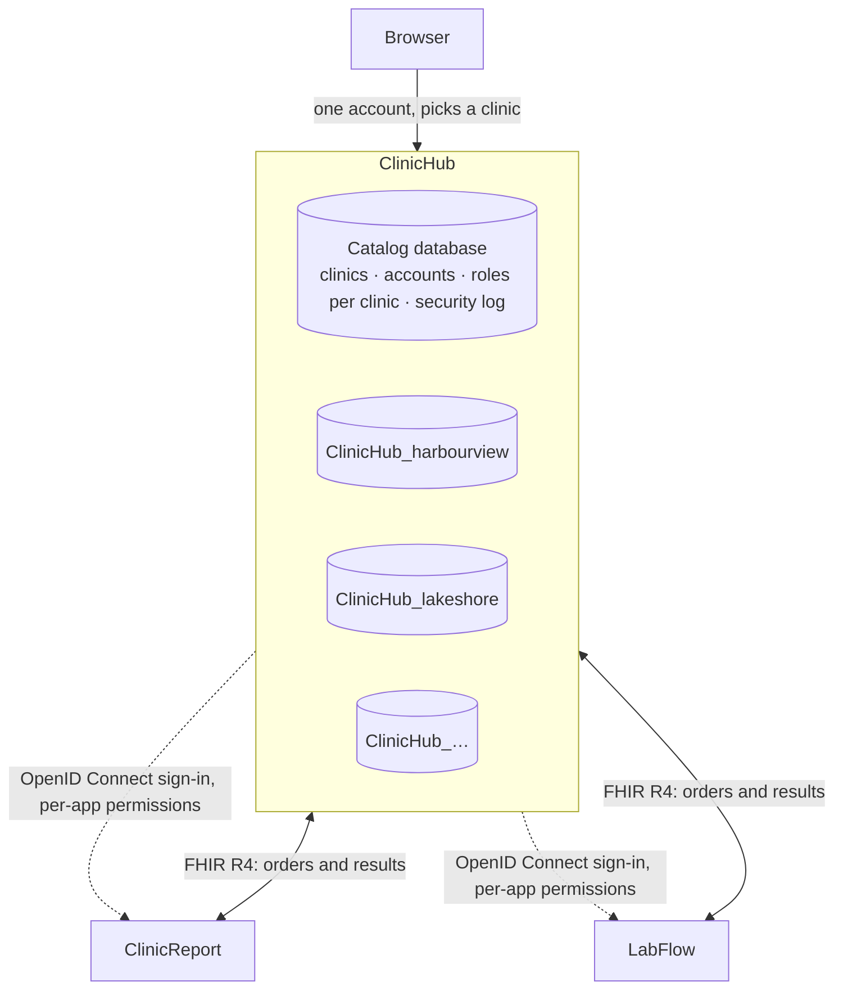

# Architecture: one sign-in, one database per clinic

ClinicHub is the hub of three applications (ClinicHub, [ClinicReport](https://github.com/ArashKeshtgar/ClinicReport),
[LabFlow](https://github.com/ArashKeshtgar/LabFlow)). This document is the plan they follow and where each
part of it stands. It exists because the plan was first only a diagram, and a diagram does not say what is done.

## Decisions

1. **ClinicHub is where people sign in.** Accounts, passwords, two-factor, lockout, roles and the security
   log live in ClinicHub's catalog database. ClinicReport and LabFlow will hold no passwords: they will
   accept ClinicHub's sign-in (OpenID Connect) and check permissions ClinicHub grants for them.
2. **One database per clinic.** The catalog knows the clinics and where each one's database is. Patients,
   visits, billing and the PHIPA access log stay in the clinic's own database; a query can't reach another
   clinic's patients because it runs on a different database.
3. **The clinic is chosen after signing in.** One account per person; roles are per clinic. Someone who
   works at two clinics (Dr. Patel in the demo, Wednesdays and Fridays at Lakeshore) picks one, and can
   switch. Their OHIP billing number is the same everywhere; each clinic's group number goes on its claims.
4. **ClinicReport keeps working on its own.** It is a separate open-source project with a live site, so it
   keeps its own sign-in as a *standalone* mode and gains a *connected* mode that uses ClinicHub.

## Phases

| Phase | What | Status |
|---|---|---|
| 1 | Catalog database, database per clinic, clinic picker and switcher; ClinicReport's account security brought into ClinicHub: temporary passwords, two-factor (TOTP), lockout, sign out everywhere, people and per-clinic roles, security log; platform administrators open clinics | **Done** |
| 2 | ClinicHub as an OpenID Connect provider: registered applications, per-application permissions in roles (`clinicreport:*`, `labflow:*`), the clinic in the token | **Done** |
| 3 | ClinicReport connected mode: sign-in through ClinicHub, its users mapped to ClinicHub accounts, a database per clinic there too, standalone mode unchanged | **Done** |
| 4 | LabFlow signs in through ClinicHub (today it has only a development sign-in) | Not started |

## How a request finds its database (phase 1)

- The sign-in cookie holds the account id, its security stamp and the chosen clinic id. On every request
  the account, its roles **in that clinic** and its provider link are re-read, so a role change applies at
  once and a new stamp ends every session.
- `ClinicDatabases` resolves the clinic's connection string from the catalog (cached), and the request's
  `ClinicHubDbContext` opens that database. Without a chosen clinic there are no permissions, so no clinic
  endpoint runs.
- Clinics share one SQL Server by default (`ConnectionStrings:ClinicServer`, database
  `{Clinics:DatabasePrefix}{slug}`); a clinic can instead have its own server, stored encrypted.
- Each clinic database keeps a slim copy of its members (`sec.User`: the account id and name, no
  credentials), so "who signed this visit" stays a foreign key inside the clinic's database. It is
  refreshed when someone joins, leaves or enters the clinic.
- On start-up the catalog is migrated, then every active clinic's database, and each clinic's built-in roles
  are completed (Administrator always gets every permission, including new ones).

## Who may change what

- A **clinic administrator** (permission `users.manage` in that clinic) adds people, sets their roles there,
  and edits the clinic's roles. Adding an existing user name gives that person a role here; they keep their
  own password and two-factor.
- An account's name, password and two-factor can be reset by a clinic's administrator only when that
  clinic is the only one the person works at; otherwise by the person or a platform administrator.
- A **platform administrator** opens clinics. Opening one creates its catalog entry and roles, creates and
  migrates its database, adds a first location, and makes the creator its administrator.
- Every clinic must always keep at least one person with `users.manage`.

## The sign-in server (phase 2)

ClinicHub is an OpenID Connect provider ([OpenIddict](https://documentation.openiddict.com/)), with its
registered applications, authorizations and tokens in the catalog database.

- **Flow:** authorization code with PKCE; refresh tokens; userinfo; sign-out. Applications are registered
  from configuration (`Sso:Clients`: client id, secret, redirect URIs, launch URL) at start-up. They are
  first-party, so there is no consent screen.
- **Signing in from an application:** `/connect/authorize` uses the ClinicHub session. Not signed in, a
  pending password or two-factor step, or no clinic chosen: the person is sent to ClinicHub's pages
  (`/signin?returnUrl=…`), which finish that and return to `/connect/authorize`. `prompt=login` signs out
  first. The ClinicHub cookie is `SameSite=Lax` so this navigation from another site carries it.
- **What the application receives:** `sub` (the account), `name`, `preferred_username`, `credentials`;
  with the `clinic` scope also `clinic_id`, `clinic_slug`, `clinic_name`, the roles held in that clinic and
  `permission`: only that application's permissions, without the prefix. A role holding
  `clinicreport:reports.sign` becomes `reports.sign` in ClinicReport's token, the key ClinicReport already
  checks. `amr: mfa` when the account uses two-factor.
- **Refusals:** someone with no permission for the application at the chosen clinic gets `access_denied`
  (and an `SsoRefused` entry in the security log). Each refresh reads the account again: deactivated, a
  new security stamp ("sign out everywhere", password change), or the permission taken away ends the
  application's session with `invalid_grant`.
- **Keys:** development uses ASP.NET's development certificates; tests use ephemeral keys; production
  sets `Sso:SigningCertificatePath`. Access tokens are signed, not encrypted, so the applications can read
  them. `Sso:Issuer` fixes the public address when ClinicHub is behind a reverse proxy (and behind Vite in
  development, where everything is on `http://localhost:5301`).
- **New permissions reach existing clinics once:** each clinic records the permission keys its built-in
  roles have been given; a key added by a new version is added to the built-in roles that list it, and a
  clinic's own later edits stand. This is how the existing demo clinics' Physician role gained
  `clinicreport:reports.sign`.
- ClinicHub's top bar links to the applications the person may open from the current clinic.

## ClinicReport connected (phase 3)

ClinicReport ([its README](https://github.com/ArashKeshtgar/ClinicReport#connected-to-clinichub)) switches to
connected mode when it is given ClinicHub's address. Then:

- Its sign-in page has one button, *Sign in with ClinicHub*. The OpenID Connect handler sends the person here, and
  on the way back ClinicHub's person becomes a user of **that clinic's own ClinicReport database**
  (`clinicreport-{clinic_slug}.db`), linked by ClinicHub's account id, so signatures and ClinicReport's
  report-access log refer to them. A local account with the same user name is taken over, keeping its history.
- Its permissions are the token's (`reports.sign`, …); roles are shown, not edited; passwords, two-factor and its
  own roles are closed. ClinicReport still sets which services a person works on, and can turn their access off.
- Every five minutes the session is renewed with ClinicHub's refresh token; `invalid_grant` ends it, so taking a
  role away in ClinicHub reaches ClinicReport within minutes. ClinicHub being unreachable is tolerated for 30.
- Signing out of ClinicReport ends the ClinicHub session (`/connect/logout`).
- Without the `ClinicHub` setting nothing changes: the public demo at report.arashkeshtgar.ca keeps its own accounts.
