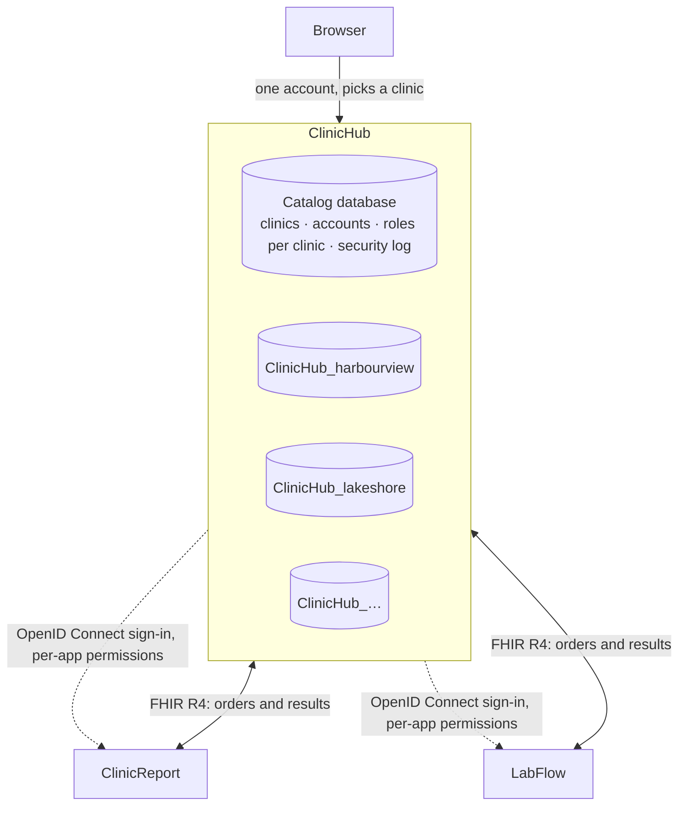
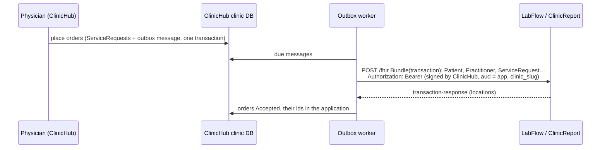
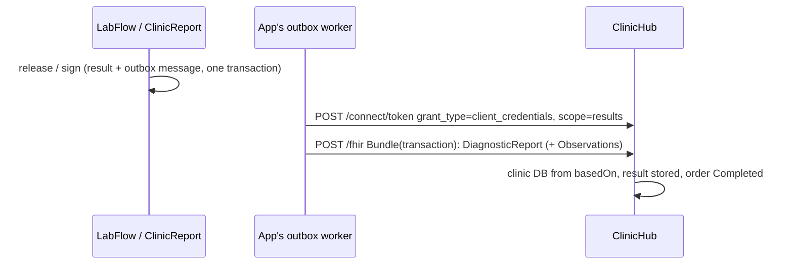

# Architecture: one sign-in, one database per clinic

ClinicHub is the hub of three applications (ClinicHub, [ClinicReport](https://github.com/ArashKeshtgar/ClinicReport),
[LabFlow](https://github.com/ArashKeshtgar/LabFlow)). This document is the plan they follow and where each
part of it stands. It exists because the plan was first only a diagram, and a diagram does not say what is done.

## Decisions

1. **ClinicHub is where people sign in.** Accounts, passwords, two-factor, lockout, roles and the security
   log live in ClinicHub's catalog database. ClinicReport and LabFlow will hold no passwords: they will
   accept ClinicHub's sign-in (OpenID Connect) and check permissions ClinicHub grants for them.
2. **One database per clinic.** The catalog knows the clinics and where each one's database is. Patients,
   visits, billing and the PHIPA access log stay in the clinic's own database; a query can't reach another
   clinic's patients because it runs on a different database.
3. **The clinic is chosen after signing in.** One account per person; roles are per clinic. Someone who
   works at two clinics (Dr. Patel in the demo, Wednesdays and Fridays at Lakeshore) picks one, and can
   switch. Their OHIP billing number is the same everywhere; each clinic's group number goes on its claims.
4. **ClinicReport keeps working on its own.** It is a separate open-source project with a live site, so it
   keeps its own sign-in as a *standalone* mode and gains a *connected* mode that uses ClinicHub.

## Phases

| Phase | What | Status |
|---|---|---|
| 1 | Catalog database, database per clinic, clinic picker and switcher; ClinicReport's account security brought into ClinicHub: temporary passwords, two-factor (TOTP), lockout, sign out everywhere, people and per-clinic roles, security log; platform administrators open clinics | **Done** |
| 2 | ClinicHub as an OpenID Connect provider: registered applications, per-application permissions in roles (`clinicreport:*`, `labflow:*`), the clinic in the token | **Done** |
| 3 | ClinicReport connected mode: sign-in through ClinicHub, its users mapped to ClinicHub accounts, a database per clinic there too, standalone mode unchanged | **Done** |
| 4 | LabFlow signs in through ClinicHub; one lab database or one per clinic, chosen in its configuration | **Done** |

## How a request finds its database (phase 1)

- The sign-in cookie holds the account id, its security stamp and the chosen clinic id. On every request
  the account, its roles **in that clinic** and its provider link are re-read, so a role change applies at
  once and a new stamp ends every session.
- `ClinicDatabases` resolves the clinic's connection string from the catalog (cached), and the request's
  `ClinicHubDbContext` opens that database. Without a chosen clinic there are no permissions, so no clinic
  endpoint runs.
- Clinics share one SQL Server by default (`ConnectionStrings:ClinicServer`, database
  `{Clinics:DatabasePrefix}{slug}`); a clinic can instead have its own server, stored encrypted.
- Each clinic database keeps a slim copy of its members (`sec.User`: the account id and name, no
  credentials), so "who signed this visit" stays a foreign key inside the clinic's database. It is
  refreshed when someone joins, leaves or enters the clinic.
- On start-up the catalog is migrated, then every active clinic's database, and each clinic's built-in roles
  are completed (Administrator always gets every permission, including new ones).

## Who may change what

- A **clinic administrator** (permission `users.manage` in that clinic) adds people, sets their roles there,
  and edits the clinic's roles. Adding an existing user name gives that person a role here; they keep their
  own password and two-factor.
- An account's name, password and two-factor can be reset by a clinic's administrator only when that
  clinic is the only one the person works at; otherwise by the person or a platform administrator.
- A **platform administrator** opens clinics. Opening one creates its catalog entry and roles, creates and
  migrates its database, adds a first location, and makes the creator its administrator.
- Every clinic must always keep at least one person with `users.manage`.

## The sign-in server (phase 2)

ClinicHub is an OpenID Connect provider ([OpenIddict](https://documentation.openiddict.com/)), with its
registered applications, authorizations and tokens in the catalog database.

- **Flow:** authorization code with PKCE; refresh tokens; userinfo; sign-out. Applications are registered
  from configuration (`Sso:Clients`: client id, secret, redirect URIs, launch URL) at start-up. They are
  first-party, so there is no consent screen.
- **Signing in from an application:** `/connect/authorize` uses the ClinicHub session. Not signed in, a
  pending password or two-factor step, or no clinic chosen: the person is sent to ClinicHub's pages
  (`/signin?returnUrl=…`), which finish that and return to `/connect/authorize`. `prompt=login` signs out
  first. The ClinicHub cookie is `SameSite=Lax` so this navigation from another site carries it.
- **What the application receives:** `sub` (the account), `name`, `preferred_username`, `credentials`;
  with the `clinic` scope also `clinic_id`, `clinic_slug`, `clinic_name`, the roles held in that clinic and
  `permission`: only that application's permissions, without the prefix. A role holding
  `clinicreport:reports.sign` becomes `reports.sign` in ClinicReport's token, the key ClinicReport already
  checks. `amr: mfa` when the account uses two-factor.
- **Refusals:** someone with no permission for the application at the chosen clinic gets `access_denied`
  (and an `SsoRefused` entry in the security log). Each refresh reads the account again: deactivated, a
  new security stamp ("sign out everywhere", password change), or the permission taken away ends the
  application's session with `invalid_grant`.
- **Keys:** development uses ASP.NET's development certificates; tests use ephemeral keys; production
  sets `Sso:SigningCertificatePath`. Access tokens are signed, not encrypted, so the applications can read
  them. `Sso:Issuer` fixes the public address when ClinicHub is behind a reverse proxy (and behind Vite in
  development, where everything is on `http://localhost:5301`).
- **New permissions reach existing clinics once:** each clinic records the permission keys its built-in
  roles have been given; a key added by a new version is added to the built-in roles that list it, and a
  clinic's own later edits stand. This is how the existing demo clinics' Physician role gained
  `clinicreport:reports.sign`.
- ClinicHub's top bar links to the applications the person may open from the current clinic.

## ClinicReport connected (phase 3)

ClinicReport ([its README](https://github.com/ArashKeshtgar/ClinicReport#connected-to-clinichub)) switches to
connected mode when it is given ClinicHub's address. Then:

- Its sign-in page has one button, *Sign in with ClinicHub*. The OpenID Connect handler sends the person here, and
  on the way back ClinicHub's person becomes a user of **that clinic's own ClinicReport database**
  (`clinicreport-{clinic_slug}.db`), linked by ClinicHub's account id, so signatures and ClinicReport's
  report-access log refer to them. A local account with the same user name is taken over, keeping its history.
- Its permissions are the token's (`reports.sign`, …); roles are shown, not edited; passwords, two-factor and its
  own roles are closed. ClinicReport still sets which services a person works on, and can turn their access off.
- Every five minutes the session is renewed with ClinicHub's refresh token; `invalid_grant` ends it, so taking a
  role away in ClinicHub reaches ClinicReport within minutes. ClinicHub being unreachable is tolerated for 30.
- Signing out of ClinicReport ends the ClinicHub session (`/connect/logout`).
- Without the `ClinicHub` setting nothing changes: the public demo at report.arashkeshtgar.ca keeps its own accounts.

## LabFlow connected (phase 4)

LabFlow ([its README](https://github.com/ArashKeshtgar/LabFlow#connected-to-clinichub)) signs staff in through
ClinicHub the same way ClinicReport does: the token's `labflow:*` permissions arrive as `frontdesk`,
`results.view`, `admin`; each person becomes a `sec.AppUser` linked by ClinicHub's account id; the session is
re-checked every five minutes; signing out there signs out here.

Where a lab's data lives is LabFlow's setting, because in Ontario a lab is usually its own business:

- **One lab database** (default): staff of every clinic work in the lab's database; the clinic they signed in
  for is known but does not split the data.
- **One database per clinic** (`ClinicHub:DatabasePattern` with `{clinic}`): for clinics that run their own
  collection room. A clinic's LabFlow database is built from LabFlow's SQL scripts at its first sign-in;
  anonymous online booking must name a clinic whose database exists.

With phase 4 every application signs in through ClinicHub, and every clinic can have its own database in each
of them. What remains of the architecture is the clinical traffic between them: orders from ClinicHub to LabFlow
and ClinicReport over FHIR, and results back (see the README's status list).

## Orders over FHIR

A clinician orders from the visit page: lab tests go to LabFlow, echo and ECG to ClinicReport.

- **One message per application per ordering:** a FHIR R4 transaction Bundle with the patient (clinic MRN, Ontario
  health card), the requester (CPSO and OHIP billing numbers) and one ServiceRequest per test (LOINC, or LabFlow's
  own code for its panels; ClinicReport's template key for exams), with the clinical note and priority. It is
  written in the same transaction as the orders, so nothing ordered is lost if an application is down.
- **Delivery:** a background worker visits every clinic's outbox, posts each due message and records the
  application's ids from the transaction-response. Failures wait 10 s, 20 s, 40 s… up to 30 min; after 12 the
  orders are marked *Not delivered*, and *Try again now* restarts them. Receivers recognise a resent Bundle.
- **Who is calling:** ClinicHub signs a five-minute token with its sign-in key: audience the application,
  scope `orders`, and the clinic. The application validates it with ClinicHub's published keys
  (`/.well-known/jwks`), and the clinic picks the database the order lands in.
- **On arrival:** LabFlow keeps an *electronic order* (database/050) until the patient comes to collection,
  where reception turns it into a requisition with the usual checks; the patient is matched by health card or
  name and birth date, the physician by billing or CPSO number. ClinicReport puts the exam on its worklist;
  *Start report* opens a draft with the indication and referring physician filled in.
- **Identifier systems** are in `Integrations/OrderCatalog.cs` (`FhirSystems`). The Ontario health card and CPSO
  systems are the Canadian baseline's; the OHIP billing number and the card's version-code extension are
  ClinicHub's own URNs, to be replaced by the provincial ones in a real deployment.

## Results back

LabFlow (when results are released) and ClinicReport (when a report is signed) send the result to ClinicHub.

- **The message:** a FHIR R4 transaction Bundle with one DiagnosticReport per ordered test, `basedOn` the
  ServiceRequest's identifier (`urn:clinichub:{clinic}:service-request|{id}`), which names the clinic database.
  LabFlow adds an Observation per analyte (LOINC, value, unit, reference range, interpretation H/L);
  ClinicReport sends the conclusion and addenda and a link to the full report (`presentedForm`).
- **Who is calling:** the application gets a token from ClinicHub with its own client id and secret
  (client credentials, scope `results`). ClinicHub accepts a result only from the application the order was sent
  to.
- **Versions:** `final` first; a LabFlow correction or a ClinicReport addendum arrives as `amended`, replaces the
  stored result and puts it back in the inbox. `cancelled` cancels the order.
- **Delivery:** each application keeps its own outbox (LabFlow `lab.OutboundMessage`, database/051; ClinicReport
  `ResultMessages`) with the same backoff as ClinicHub's, so a result is not lost while ClinicHub is down.
- **Results inbox** (`/results`): the clinic's results, abnormal first, *My orders* or *Whole clinic*; the
  physician acknowledges each (`results.review`, logged under PHIPA). The visit page shows the result with the
  order.

## Cancelling an order

*Cancel order* on the visit page, with an optional reason that goes to the application.

- **Not delivered yet** (sending, or not delivered): cancelled in ClinicHub at once. The order comes out of its
  waiting message, and a message with nothing left in it is removed.
- **Delivered:** the order shows *Cancelling…* and a message goes through the outbox: the same ServiceRequest with
  `status: revoked`, as a conditional update (`PUT ServiceRequest?identifier=urn:clinichub:{clinic}:service-request|{id}`),
  the reason in a note. A `200` cancels the order.
- **The application decides.** LabFlow strikes the test from a waiting order, or cancels the requisition item if no
  result has been entered; ClinicReport cancels an exam that has not been started. Otherwise they answer `409` with
  an OperationOutcome; the order goes back to where it was and shows the answer ("Results have been entered…; call
  the lab"). A refusal is an answer, not a failure: it is not retried.
- A resulted order can no longer be cancelled.

## Electronic prescriptions

*Prescribe…* on the visit page, for a physician or a nurse practitioner (permission `prescriptions.write`, which the
Physician role has and the nurse and front-desk roles do not). Each drug is one `Prescription`; the drugs written
together share a number and one outgoing message, the way the tests of an order share a requisition.

- **Who prescribes.** The signed-in person must be a clinician with a provider record at the clinic, of kind physician
  or nurse practitioner, **with a college registration number** (409 otherwise: ask an administrator to add it).
  Writing it is signing for it; the visit may be open or signed, not voided. The visit's consent directives apply
  as for orders: a visit withheld from the prescriber cannot be prescribed in.
- **What is written.** A drug from the catalog by DIN, directions (3 to 200 characters), a quantity (1 to 9999, in the
  drug's unit), days of supply (optional, 1 to 365), refills (0 to 11), *no substitution*, a note for the pharmacist
  (500). Up to 10 drugs at a time; a drug already prescribed at the same visit (not cancelled or failed) is refused,
  and nothing is saved unless every line is right.
- **The catalog is a demo.** `PrescriptionCatalog`: 29 drugs with the made-up DINs of PharmaFlow's demo catalog (99…),
  never to be dispensed from; a production catalog comes from Health Canada's Drug Product Database. **Controlled
  drugs are left out on purpose** (narcotics, benzodiazepines, stimulants: no refills, monitoring submission, stricter
  rules for electronic transmission).
- **One transaction, one message.** The prescriptions and their message are saved together; the outbox worker delivers
  it to the pharmacy with the usual retries (10 s, 20 s, 40 s… up to 30 min, 12 tries, then *Not delivered* and *Try
  again now*). `Integrations:PharmaFlow:FhirBaseUrl` is where it goes: PharmaFlow's `/fhir`, or IntegrationHub's route
  `http://localhost:5700/route/pharmaflow/fhir`. Empty: the card says the pharmacy is not connected and prescriptions
  wait.
- **The Bundle** (IntegrationHub's contracts, flow 5): a transaction with the Patient and the Practitioner as in an order
  (CPSO and OHIP billing numbers), then one `MedicationRequest` per drug: `identifier`
  `urn:clinichub:{clinic}:prescription|{id}`, `groupIdentifier` `…:prescription-group|G{n}` (also the Bundle's own
  identifier), the drug as a DIN coding (`http://hl7.org/fhir/NamingSystem/ca-hc-din`), the directions, `dispenseRequest`
  (quantity and unit, refills, supply duration), `substitution.allowedBoolean`, the note. A Bundle sent again is the same
  prescription.
- **The token** is ClinicHub's own, like an order's, for the pharmacy: `aud` `pharmaflow`, scope **`prescriptions`**
  (orders carry `orders`), `clinic_slug`.
- **Cancelling.** *Cancel prescription*, with an optional reason. Not delivered yet: cancelled at once, taken out of
  its message (a message with nothing left is removed). Delivered: *Cancelling…* and the same MedicationRequest goes
  again with `status: cancelled`, a conditional `PUT MedicationRequest?identifier=…|{id}` and the reason in a note. A
  `200` cancels it; **`409` (or 400, 404, 422) is the pharmacy saying no** (it has begun to dispense): the prescription
  goes back to *At the pharmacy* with the answer as its note, and is not retried.
- **Not checked here:** allergies, interactions and duplicate therapy. ClinicHub keeps no allergy list; the pharmacy
  checks when it receives the prescription (PharmaFlow's reception does).
- **Not built, said plainly.** PharmaFlow has no intake for these yet, so nothing has been seen to arrive in a real
  pharmacy (tested against a fake one, and through IntegrationHub in a real run); no refill or renewal flow, no
  dispensed or picked-up status coming back, no printing, no confidentiality label on a prescription of a patient with
  a directive (IntegrationHub's contract flow 7), no merge message (flow 6), no allergy list, no controlled drugs,
  and a demo catalog.

## Master patient index

One record per person in each clinic's database. *Patients* (`/patients`) finds, registers and corrects them; the
front desk registers (`patients.edit`), the privacy officer and administrators review duplicates and merge
(`patients.merge`).

- **Registering:** names, birth date and sex are required. An Ontario health card must pass its check digit and
  can be on only one live record: a second one is refused, naming the record that has it. The MRN continues the
  clinic's own series (`HV000401` after `HV000400`).
- **How alike two records are** (`Domain/PatientMatching.cs`): a score out of 100 from the mistakes a front desk
  makes: same or one-typo birth date (day and month swapped included), last name the same, one letter off or
  sounding the same (Soundex), first name the same, a short form or a preferred name, same phone, email, postal
  code. A different sex counts against; **two different health cards count strongly against** (almost always two
  people). Only records sharing a birth date, phone, email, or birth year and sound-alike last name are compared.
- **At registration** a match of 80 or more stops the clerk: they open the existing record, or confirm it is
  someone else. Confirmed or not, every match of 60 or more goes to the review queue in case they were wrong. A
  correction that makes a record look like another one also queues the pair.
- **Review queue:** the two records side by side with their differences marked. *Not the same person* closes the
  pair for good (a later scan does not ask again); *Scan all records* compares the whole clinic. The demo clinics
  start with four such pairs (MRNs `…401`–`…404`: no card, a mistyped last name, day and month swapped, a short
  first name).
- **Merging** keeps the record chosen (by default the one with more visits) and moves everything of the other to
  it, in one transaction: appointments, visits and eligibility checks, referrals, orders, claims, invoices, consent
  directives. Empty fields of the kept record are filled from the other, the health card included. The merged
  record stays, pointing at the kept one: searching its MRN opens the kept record, and it can no longer be edited.
  Records with two different health cards are not merged; one card has to be corrected first.
- **PHIPA:** opening, registering, correcting, reviewing and merging are written to the access log. The log is
  not rewritten by a merge (it records which record was opened); a patient's log includes the records merged into
  theirs.
- **The other applications:** orders not delivered yet are rebuilt under the kept record. LabFlow and ClinicReport
  are **not told** about a merge: orders they already received keep the old MRN, and results for them still reach
  the right person because they come back by order. Sending FHIR `Patient` links to them is not built.
- **Not built:** undoing a merge, and merging across clinics (each clinic's database is its own index).

## Consent directives (PHIPA lockbox)

A patient may withhold part of their record. The privacy officer (`consent.manage`) records the directive on the
patient (*Patients* → the patient → *Consent directives*) and records its withdrawal; both stay in the history and
in the access log. The rules are in `Domain/ConsentGuard.cs`.

| Directive | Who still sees a visit |
|---|---|
| Entire record | The provider who saw the patient at that visit; while the visit is still open, the team working on it (rooming, vitals) |
| One visit | Only the provider who saw the patient at that visit |
| From one provider | Everyone except that provider, who still sees the visits they saw themselves |

- **What is withheld:** visits: the note, vitals, diagnoses and codes, orders and results. **Not withheld:** who the
  patient is, appointments and check-in, billing. The clinic needs those to book, register and be paid, and the
  directive is about health information shared within the care team.
- **What a clinician sees:** opening a withheld visit (or its orders) answers `403` and the page says *Withheld at the
  patient's request*. Earlier visits withheld from them are left out of the visit page with a count. In the results
  inbox a withheld result shows only that it exists and cannot be acknowledged.
- **Emergency override** (`consent.override`, Physicians by default): a reason of 10 characters or more opens the
  whole record to that clinician for one hour. Every directive gets its own override row; everything opened under it
  is in the access log marked *Override*; *Logs → Consent overrides* lists them all for the privacy officer.
- **Merging** moves the directives to the kept record.
- **Demo:** each demo clinic with a privacy officer starts with one patient whose entire record is withheld (a signed
  visit by someone other than Dr. Patel, when today has one).
- **Not built:** LabFlow and ClinicReport are not told about directives, so an order sent to them is not marked as
  withheld there; telling the patient about an override is the privacy officer's job, outside ClinicHub.

## Money to the accounting (FinancePowerApp)

The clinic's money goes to [FinancePowerApp](../../FinancePowerApp), the group's accounting, as financial documents
(`Integrations/FinanceFeed.cs`). They are built from the billing tables as they are, each with an id that never
changes, sent on the outbox worker's pass and marked in `billing.FinanceExport` once accepted; FinancePowerApp also
recognises a document sent twice.

| In ClinicHub | Document | In the books |
|---|---|---|
| A claim ready for OHIP (or WSIB) | Invoice to OHIP (WSIB), `OHIP.Professional` (`OHIP.Reciprocal` for another province's patient, which OHIP pays and recovers) | Receivable from OHIP, OHIP fees, by provider |
| A remittance advice | Receipt from OHIP by EFT, one line per claim paid | The claims' receivables paid down |
| A claim paid less than billed (final) | Adjustment `Adjustment.ShortPaid` | The rest written off |
| A physician's share of a remittance, net of overhead | Bill from the physician (`Expense.PhysicianShare`) | Physician fees, payable to the physician |
| An invoice for uninsured services / a payment on it | Invoice to "Patients" with its HST / Receipt | Receivable from patients, uninsured services, HST payable |

- **No health information leaves:** no patient names, health cards, diagnoses or fee codes. Patients are one party;
  invoices and claims are known by their numbers.
- A refused claim stays owed until it is resubmitted and paid, or written off in the accounting.
- **Who is calling:** a five-minute token ClinicHub signs (audience and scope `finance`, the clinic slug), checked by
  FinancePowerApp against ClinicHub's published keys. LabFlow and ClinicReport get theirs with client credentials and
  the scope `finance`; ClinicHub gives such tokens the audience `finance`.
- Set `Integrations:Finance:BaseUrl` to turn it on (development: `http://localhost:5400`; FinancePowerApp started
  with `--launch-profile connected`).

