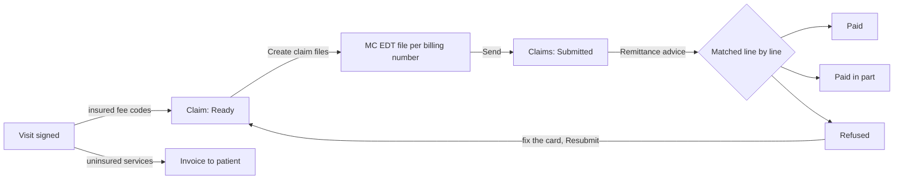

# OHIP billing in ClinicHub

How a signed visit becomes money, and what the clinic can check along the way. Code:
`src/ClinicHub.Api/Domain/OhipFiles.cs` (file layouts), `Domain/OhipSimulator.cs` (adjudication),
`Endpoints/BillingEndpoints.cs` (the workflow).

## The cycle

1. **Signing** a visit (`Domain/EncounterSigning.cs`) turns its OHIP fee codes into one claim with
   an 8-character accounting number (the encounter number), the health card as it was on that day,
   and the primary diagnostic code on every item. Providers without a billing number (salaried nurse
   practitioners) get no claim. Uninsured services go on an invoice instead.
2. **Create claim files**: every Ready OHIP (HCP) and reciprocal (RMB) claim not yet in a file goes
   into one file per billing number. WSIB claims are not billed to OHIP and stay out.
3. **Send** stands in for the MC EDT upload. ClinicHub is not onboarded with the Ministry, so the file
   is accepted as is.
4. **Remittance advice**: either *Simulate remittance*, which adjudicates everything submitted with the
   rules below and writes a remittance file, or *Import file* for a file received. Both go through the
   same reader. Every paid line is matched to the claim item it pays (accounting number, service code,
   service date). A claim is **Paid** when every item is paid in full, **Paid in part** when some
   money came, **Refused** when nothing did. A file is **Settled** once none of its claims is waiting.
5. **Reconciliation** shows, per provider, what was claimed and paid, the clinic's overhead share, and
   what goes to the provider; and every line paid differently from what was claimed, with the reason.

## File layouts

Fixed-width records of 79 characters, CR LF line ends, upper-case ASCII. Alphanumeric fields are
left-justified and space-filled; numeric fields are right-justified and zero-filled; money is in cents.
The layouts follow the published structure of Ontario's claim and remittance files closely enough to
show the work. **ClinicHub has not been certified by the Ministry**: the files are realistic samples,
not conformant submissions, and a real installation must be tested against the current
Technical Specifications.

### Claims file (`HJ123456.004`: H, month letter, billing number, batch sequence)

| Record | Fields (length) |
|---|---|
| `HEB` batch header | spec version `V03` (3), office code (1), batch date (8), batch sequence (4), operator (6), group number (4), billing number (6), specialty (2), reserved (42) |
| `HEH` claim header | health number (10), version code (2), birth date (8), accounting number (8), payment program `HCP`/`RMB` (3), payee `P` (1), referring provider (6), master number (4), admission date (8), referring lab (4), manual review (1), service location (4), reserved (17) |
| `HER` reciprocal patient, RMB only | out-of-province registration number (12), last name (9), first name (5), sex `1`/`2` (1), province (2), reserved (47) |
| `HET` item | service code (5), reserved (2), fee in cents (6), number of services (2), service date (8), diagnostic code (4), reserved (49) |
| `HEE` trailer | HEH count (4), HER count (4), HET count (4), reserved (64) |

A reciprocal claim leaves the Ontario health number blank on `HEH` and identifies the patient on `HER`.

### Remittance advice (`PJAB1210.RA`: P, month letter, group number, day)

| Record | Fields (length) |
|---|---|
| `HR1` header | spec version (3), group number (4), billing number (6), payment date (8), payee name (30), total paid in cents (9), sign (1), cheque number (8), reserved (7) |
| `HR4` claim | claim number (11), transaction type (1), billing number (6), specialty (2), accounting number (8), health number (12), version code (2), payment program (3), service location (4), group number (4), reserved (23) |
| `HR5` item | claim number (11), transaction type (1), service date (8), number of services (2), service code (5), reserved (1), amount submitted (6), amount paid (6), sign (1), explanatory code (2), reserved (33) |
| `HR8` message | text (70), reserved (6) |

The reader skips record types it does not use (balance forward, accounting transactions), refuses a
file whose header total differs from its items, and names the line of any malformed record.

## The adjudication simulator

Applied in this order to each item; the first that matches refuses the item with its code. The codes
are **the simulator's own**, not the Ministry's explanatory codes.

| Code | Rule |
|---|---|
| `RN` | Reciprocal claim without the out-of-province health number |
| `EX` | Ontario health number fails the check digit, or the card expired before the service date |
| `VC` | Version code on the claim differs from the patient's card (a new card was issued) |
| `ST` | Stale-dated: received more than six months after the service |
| `SC` | Service code not in the active fee list |
| `DU` | Same patient, service code and date already paid (earlier or in the same file) |
| `AD` | Not a refusal: paid at the Schedule of Benefits fee because more was claimed |

Everything else is paid as claimed. The seeded fee list is a small illustrative subset with approximate
fees; a real installation imports the current Schedule of Benefits.
