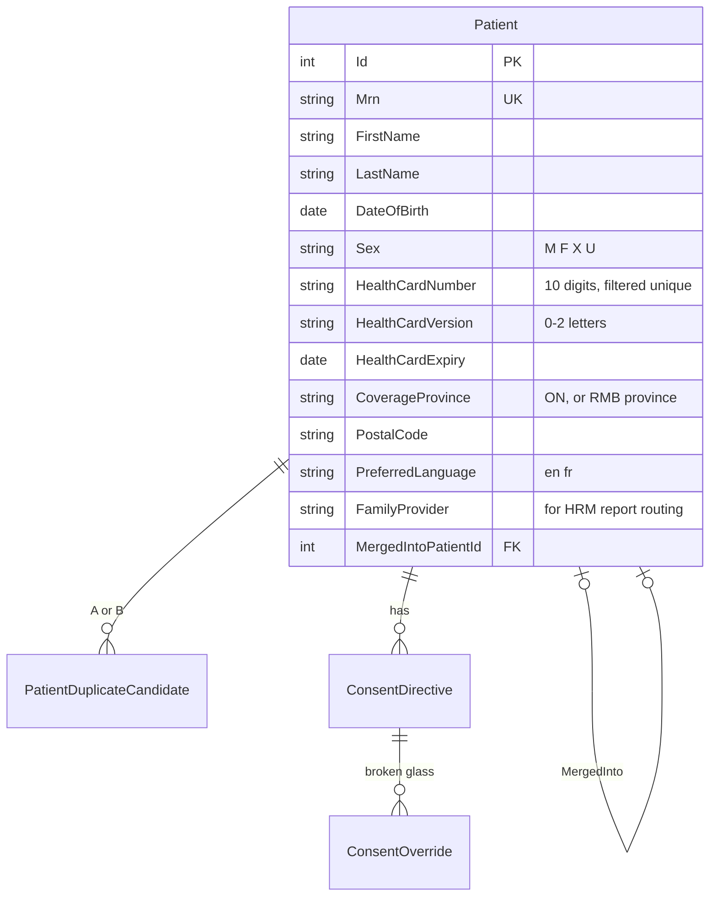
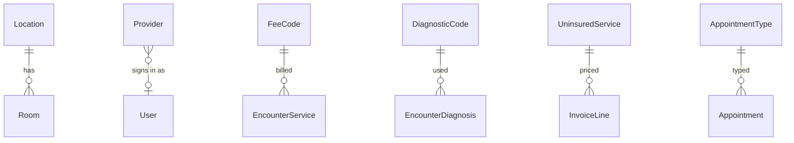
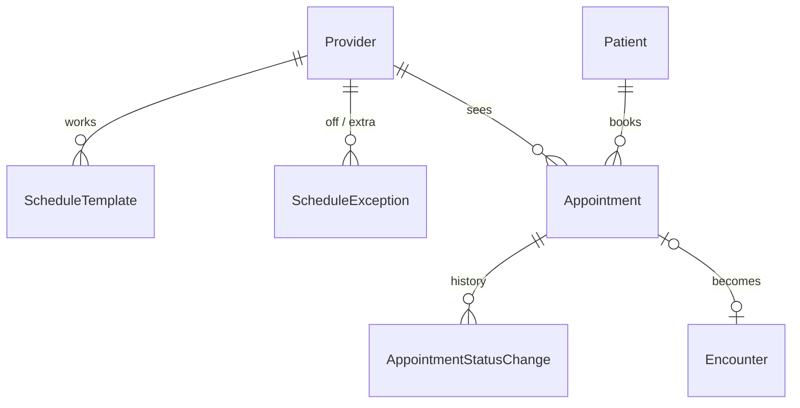
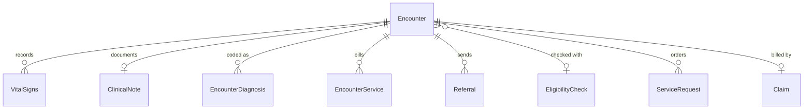
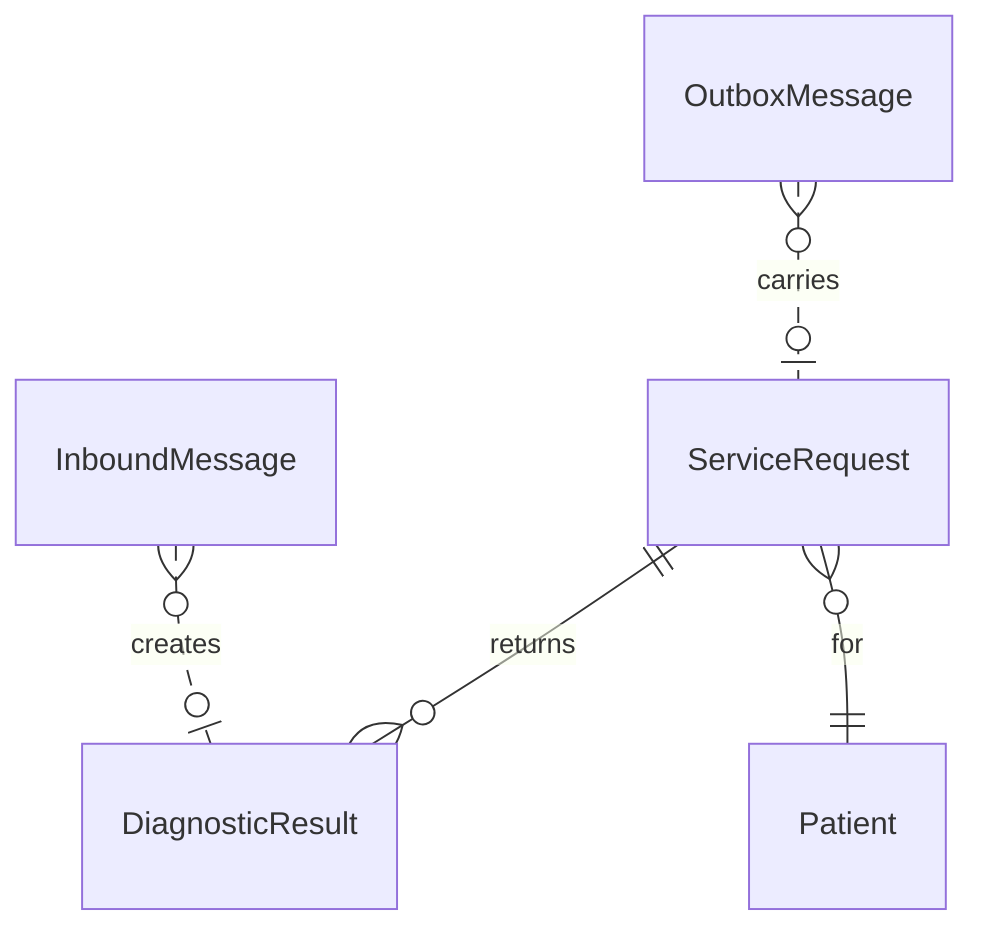
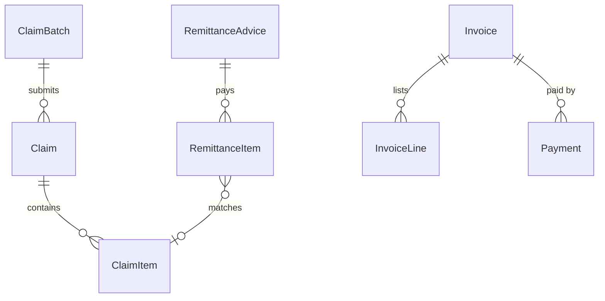

# ClinicHub database schema

SQL Server, created by EF Core migrations (`src/ClinicHub.Api/Data`). One database per clinic. Tables are
grouped into schemas by concern; PHI (names, health card, contact details) lives only in `people`.
Every other area refers to a patient by `PatientId`.

| Schema | Holds | Legacy counterpart (see [mapping](totalsystem-to-ontario.md)) |
|---|---|---|
| `ref` | OHIP fee codes, diagnostic codes, uninsured price list, appointment types, provinces | `OJ_Actions`, `CaliforniaCodes`, `Disease`, `Bimeh` |
| `clinic` | Locations, rooms, providers | `OJ_Center`, `Parts`, `Doctors` |
| `people` | Patients, duplicate candidates, PHIPA consent directives | `informat`, `OJ_PRV` demographics |
| `sched` | Session templates, exceptions, appointments and their status history | `Doctors.maxnobat`, `IvfTurn` |
| `care` | Eligibility checks, encounters, vitals, notes, diagnoses, billable services, referrals | `OJ_PRV`, `OJ_UseActions`, `Tbl_Teryaj`, `tbl_moshavereh` |
| `orders` | Service requests to LabFlow / ClinicReport and the results that come back; integration outbox/inbox | paraclinic requests, SEPAS queues |
| `billing` | OHIP claims and batches, remittance advice, uninsured invoices and payments | `cashok`, `BillSafe`, `Pregive`, insurer lists |
| `sec` | Users, roles, permissions, security events, patient access log | `Users`, `Access`, `Tbl_Users_LoginLog` |

## Conventions

- Keys are `int` identities (`bigint` for logs). Every relationship is a foreign key.
- Instants are `datetime2` in **UTC** with a `Utc` suffix; calendar dates (date of birth, service date)
  are `date`. Display is in America/Toronto.
- Money is `decimal(10,2)`; claim files carry cents.
- Status columns are short strings (`'Booked'`, `'Submitted'`), constrained in code, readable in SQL.
- Rows that people edit concurrently carry a `rowversion`.
- Nothing is hard-deleted that a patient, a payer or an auditor may ask about: appointments are
  cancelled, encounters voided, invoices voided, patients merged.

## people — the master patient index

- Health card number: 10 digits with a Luhn check digit; version code 0–2 letters. Unique among
  non-merged patients (filtered index).
- **Duplicate candidates** are found by health card, then name + date of birth similarity; staff confirm
  or dismiss. A merge points the old record at the survivor and moves its appointments, encounters,
  orders and invoices — the legacy system's 374,000 person rows for 144,000 people is the reason.
- **Consent directives** (PHIPA "lockbox"): a patient can withhold all or part of their record, or
  withhold it from a named provider. A clinician can override in an emergency; every override is logged
  and reported to the privacy officer.

## clinic and ref — who, where, what can be billed

- **Provider**: CPSO registration number, 6-digit OHIP billing number (physicians and nurse
  practitioners who bill), 2-digit OHIP specialty code, overhead percentage the clinic keeps (the
  legacy `Doctors.saham`, inverted).
- **Location**: address, OHIP group number used on claims.
- **FeeCode**: service code with suffix (`A007A`), description, fee, effective date. Seeded with a small
  illustrative subset; the real Schedule of Benefits is loaded from the Ministry file.
- **DiagnosticCode**: 3-digit OHIP diagnostic codes (subset seeded).
- **UninsuredService**: the clinic's own price list (sick notes, forms, travel vaccines…), with HST rate.

## sched — sessions and appointments

- **ScheduleTemplate**: provider × location × weekday × hours × slot length, with a flag for walk-ins.
- **Appointment**: start/end, type, source (`Phone`, `Online`, `WalkIn`, `Referral`), queue number for
  walk-ins, status `Booked → Arrived → Roomed → WithProvider → Completed`, or `NoShow` / `Cancelled`.
- **AppointmentStatusChange** keeps each transition with time and user: waiting-room and door-to-doctor
  times come from here.

## care — the visit

- **EligibilityCheck**: health card validation at check-in — number and version sent, response code,
  eligible or not, simulated flag (real HCV needs Ministry onboarding).
- **Encounter**: patient, provider, location, optional appointment, kind (`Office`, `WalkIn`, `Virtual`,
  `Procedure`), payment program (`HCP` Ontario, `RMB` other province, `WCB` workplace injury,
  `Uninsured`), optional CTAS level, check-in / start / end times, signed by and when.
- **ClinicalNote**: SOAP sections; locked once the encounter is signed (addenda only).
- **EncounterService**: what was done — an OHIP fee code or an uninsured service, units, fee.
- **Referral**: to a specialty or named provider, urgency, channel (`Fax`, `eReferral`), status.

## orders — LabFlow and ClinicReport

- **ServiceRequest**: target system (`LabFlow`, `ClinicReport`), code and display (LOINC panel or
  ClinicReport template key), priority, status, the other system's id.
- **DiagnosticResult**: status (`Preliminary`, `Final`, `Amended`), summary, abnormal flag, link to the
  full report, and **who reviewed it and when** — every result must be acknowledged by a clinician
  (results inbox).
- **OutboxMessage / InboundMessage**: FHIR R4 payloads written in the same transaction as the change and
  delivered by a background worker, so an order is never lost if LabFlow is down.

## billing — OHIP claims and private invoices

- **Claim**: one per encounter and payment program; health card snapshot, referring provider when
  needed, an 8-character **accounting number** used to match the remittance advice, status
  `Draft → Ready → Submitted → Paid / PartiallyPaid / Rejected`.
- **ClaimItem**: service code, service date, units, diagnostic code, fee submitted, fee paid,
  explanatory code from the remittance.
- **ClaimBatch**: the generated MC EDT file (header, claims, items, trailer) for one billing number.
- **RemittanceAdvice / RemittanceItem**: the monthly payment file, matched back to claim items;
  differences become a rejection worklist.
- **Invoice / InvoiceLine / Payment**: uninsured services billed to the patient or a third party
  (employer, insurer, lawyer), paid by cash, debit, credit or e-transfer.

## sec — access and the PHIPA trail

Same model as ClinicReport: users hold roles, roles are sets of permissions, security stamp, lockout,
two-factor. Permissions for a clinic:

| Permission | Typical role |
|---|---|
| `patients.view`, `patients.edit` | Front desk, nurse, physician |
| `patients.merge` | Health records clerk |
| `schedule.view`, `schedule.manage` | Front desk |
| `encounters.view`, `encounters.document` | Nurse, physician |
| `encounters.sign`, `orders.manage`, `results.review` | Physician, nurse practitioner |
| `billing.view`, `billing.manage` | Billing clerk |
| `consent.manage`, `consent.override` | Privacy officer / physician (emergency) |
| `users.manage`, `audit.view`, `settings.manage` | Administrator, privacy officer |

- **SecurityEvent**: sign-ins, account and role changes (as in ClinicReport).
- **PatientAccessLog**: every open, edit, print or export of a patient's record — who, when, from where,
  in which context, and whether a consent directive was overridden. Answers the PHIPA question
  "who has looked at my record?".
